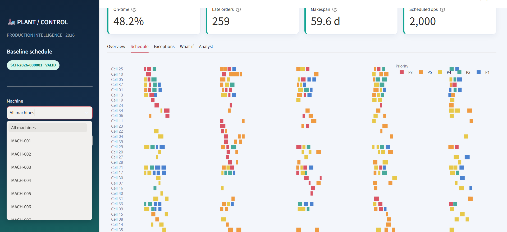
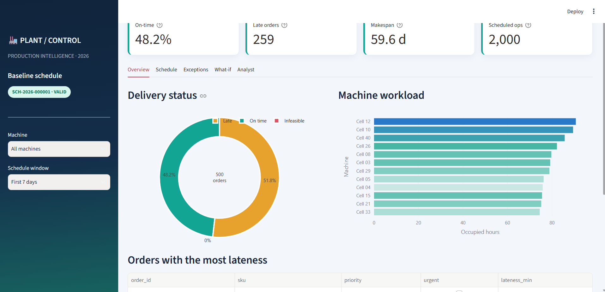

# Production Scheduling Dataset Generator with RAG and LLM Services

A deterministic, explainable production-planning demo. It generates synthetic factory data, schedules operations against routing and resource constraints, validates the result, injects five controlled anomaly cases, and exports data and evidence. An optional retrieval and LLM layer explains validator findings, supports guarded natural-language SQL, and runs downtime what-if scenarios.

The deterministic core is the source of truth. The LLM does not generate data, choose the baseline schedule, inject anomalies, or determine ground-truth labels.

## Project overview and architecture

```text
                         DETERMINISTIC CORE
 Seed + scale ──► Master data ──► Transactions ──► Priority scheduler
                                                  │
                           ┌──────────────────────┴────────────────────┐
                           ▼                                           ▼
                    Clean schedule                           Isolated anomaly copies
                           │                                           │
                           └───────────────────┬───────────────────────┘
                                               ▼
                                      Rule-based validator
                                       │              │
                                       ▼              ▼
                               KPI / evidence    Ground truth labels
                                       │          (separate folder)
                                       ▼
                            CSV / JSON / SQLite / SQL
                                       │
                    ┌──────────────────┴──────────────────┐
                    ▼                                     ▼
           Rules + dictionary +                   Read-only schedule data
           validator evidence                             │
                    └──────────────────┬──────────────────┘
                                       ▼
                         Sparse local RAG retriever
                                       │
                         Optional compatible LLM API
                  Explainer · NL-to-SQL · what-if workflow
                                       │
                              FastAPI + Streamlit
```

The main workflow is orchestrated by `src/generator.py` and exposed through `src/cli.py`. Master records are created before dependent transactions; schedule and order state transitions are retained as event rows. The validator checks the baseline and each independently mutated scenario. Ground-truth labels are exported separately and are not inputs to retrieval or prompts.

See the generated [data dictionary](docs/data_dictionary.md) for field rules, keys, and relationship cardinalities.

## Scale and volume parameters

Default run uses seed `20261022`, a 180-day horizon, and four operations per order.

| Entity or parameter | Requested baseline | Default generator output |
|---|---:|---:|
| Products / SKUs | 100 | 100 |
| Machines | 40 | 40 |
| Production orders | 500 | 500 |
| Operations | About 2,000 | 2,000 |
| Materials | 200 | 200 |
| Operations per order | 4 | 4 |
| Calendar shifts per machine | 3 | **1 weekday DAY shift** |

**Calendar scope:** the current generator creates one 08:00–16:00 shift, Monday through Friday, for each machine. It does not yet generate three shifts per machine. This is a known difference from the requested target and is stated here rather than presenting the target as implemented. Downtime records are generated for a subset of machines; urgent orders, delayed material lots, shared tooling, and sequence-dependent changeovers are included.

Scale is parameterized; starter and full datasets use the same generator:

```powershell
python -m src.cli generate --seed 20261022 --skus 10 --machines 8 --orders 30 --materials 20
```

Available options are `--seed`, `--skus`, `--machines`, `--orders`, `--materials`, `--operations-per-order`, `--horizon-days`, `--output`, and `--verify-reproducibility`. The default output root is `data`.

## Determinism and reproducibility

All event times are integer minutes from the fixed epoch `2026-01-01T00:00:00Z`; generation does not depend on the wall-clock time. Given the same seed, scale, code, and generation order, the exported records are repeatable.

`numpy.random.SeedSequence` can spawn independent child streams for separate phases. That design isolates phases: adding a random draw to master-data generation would not shift the transaction-generation stream. **The current implementation does not use NumPy or `SeedSequence`.** It uses one Python `random.Random(seed)` instance shared by master-data and transaction generation. Its current guarantee is repeatability for the same implementation and call order, not phase-independent streams.

Run the built-in reproducibility check:

```powershell
python -m src.cli generate --seed 20261022 --verify-reproducibility
```

The CLI generates twice in memory and compares SHA-256 hashes of canonicalized table rows. A mismatch fails the command. The first run's results are exported to `data/clean/dataset_checksums.json`, and the check result is written to `data/clean/reproducibility.json`. `docs/source_manifest.json` also records SHA-256 hashes for exported files.

## Setup and installation

Python 3.11 or newer is required (`pyproject.toml` declares Python `>=3.11`). From the repository root, create and activate a virtual environment.

### Windows PowerShell

```powershell
py -3.11 -m venv .venv
.\.venv\Scripts\Activate.ps1
python -m pip install --upgrade pip
python -m pip install -r requirements.txt
```

If PowerShell blocks activation for the current terminal, use:

```powershell
Set-ExecutionPolicy -ExecutionPolicy RemoteSigned -Scope Process
.\.venv\Scripts\Activate.ps1
```

### macOS or Linux

```bash
python3.11 -m venv .venv
source .venv/bin/activate
python -m pip install --upgrade pip
python -m pip install -r requirements.txt
```

The requirements file installs the generator, tests, FastAPI service, Streamlit dashboard, and plotting dependencies. SQLite is provided by Python's standard library. If GNU Make is installed, the repository provides these targets:

| Target | Action |
|---|---|
| `make install` | Install `requirements.txt` |
| `make test` | Run the complete pytest suite |
| `make generate` | Generate the default dataset |
| `make reproduce` | Generate and compare same-seed table hashes |
| `make serve` | Start FastAPI on its default local address and port |
| `make ui` | Start the Streamlit dashboard |

## Execution commands

Generate and verify the default dataset:

```powershell
python -m src.cli generate --seed 20261022 --verify-reproducibility
```

Run the test suite:

```powershell
python -m pytest -q
```

Start the API and UI in separate terminals from the project root (after generating data):

```powershell
python -m src.cli serve --data data --host 127.0.0.1 --port 8000
```

```powershell
python -m streamlit run ui/app.py
```

Open the Streamlit URL printed in its terminal, normally `http://localhost:8501`. The dashboard reads generated CSV files; its analyst and what-if actions call the API at `http://127.0.0.1:8000` by default. Configure a different URL with `SCHEDULING_API_URL`. The API's interactive documentation is available at `http://127.0.0.1:8000/docs`.

## Results and performance metrics

The following values are from the repository's default generated dataset at seed `20261022` and the default scale. They are deterministic dataset outputs, not a throughput benchmark.

| Measure | Result |
|---|---:|
| Baseline validation | Valid; 0 findings |
| Scheduled operations | 2,000 |
| Infeasible operations | 0 |
| Makespan | 85,857 min (about 59.6 elapsed days from the epoch) |
| Processing time | 135,465 min |
| Late orders | 259 of 500 (51.8%) |
| Total order lateness | 6,496,362 min |
| Maximum order lateness | 57,458 min (about 39.9 days) |

Among the 259 late orders, median lateness is 22,867 min (about 15.9 days), the 90th percentile is about 44,523 min (30.9 days), and mean lateness is about 25,082 min (17.4 days). Lateness is calculated from each order's final scheduled operation and due minute; due dates are a KPI, not a hard scheduling constraint.

### Validation and anomaly evaluation

The baseline validator reports zero issues. The anomaly test suite creates five isolated mutated schedules—machine overlap, precedence violation, material consumed before availability, outside-shift scheduling, and omitted changeover—and asserts that each yields exactly its expected validator finding. On this five-case fixture, measured class-level precision and recall are both `1.0` (5/5 detected, with no extra findings in the individual scenarios). This is a deterministic unit-test result, not a statistical guarantee for arbitrary schedules or an evaluation of LLM classification.

Run `python -m pytest tests/test_anomaly.py -v` to repeat the focused evaluation. Detailed metrics and findings are exported to `data/clean/validation_summary.json` and each scenario's `data/mutated/<issue_type>/validation_summary.json`.

## Visualizations and dashboard

The responsive Streamlit control tower includes:

- **Interactive Gantt board:** scheduled operations by machine, with filters for machine and order.
- **Machine workload chart:** compares assigned operation count and occupied time across resources.
- **Delivery and exception views:** lateness KPIs, order status, validator findings, and scenario evidence.
- **What-if and analyst controls:** submit downtime scenarios and read-only questions through the API.

Screenshot placeholders for repository captures:






The screenshot files are placeholders, not generated assets. Add screenshots at these paths when captures are available.

## AI and retrieval layer

The local retriever uses deterministic sparse TF-IDF scoring; it does not require a hosted embedding service or vector database. Its corpus is built from business-rule text, field names from the data dictionary, and validator summaries/findings. Ground truth is not loaded by the retriever.

Optional LLM-backed functions use an OpenAI-chat-completions-compatible endpoint. Set the key, base URL, and model in the environment for the API process:

```powershell
$env:LLM_API_KEY = "your-key"
$env:LLM_BASE_URL = "https://your-provider.example/v1"
$env:LLM_MODEL = "your-model"
python -m src.cli serve --data data
```

The default endpoint is `https://api.openai.com/v1` and the default model is `gpt-4o-mini`; any compatible provider can be selected with the environment variables. Never commit API keys. Core generation, validation, dashboard metrics, and deterministic what-if rescheduling do not require an LLM key. The natural-language explainer and NL-to-SQL require a configured compatible LLM service.

The SQL analyst uses a read-only SQLite connection and rejects non-`SELECT`, multi-statement, and over-limit results. What-if downtime generates a new schedule version and event records; it does not overwrite the baseline. The main API routes are `/api/summary`, `/api/issues`, `/api/explain`, `/api/ask-sql`, and `/api/what-if`.

## Data outputs and traceability

```text
data/
├── clean/          # Baseline CSV/JSON, SQLite and SQL seeds, metrics, hashes
├── mutated/        # One copied schedule per injected anomaly and validator report
└── ground_truth/   # Separate labels; do not use as model input
docs/
├── data_dictionary.md
├── data_dictionary.json
├── source_manifest.md
└── source_manifest.json
```

Identifiers are stable and table-scoped: products use `PROD-2026-000001`, orders use `PROD-2026-000001` in their separate table, routings use `ROUTE-<sku>-01`, operations use `OP-<order-id>-01`, machines use `MACH-001`, and schedules use `SCH-2026-000001`. The data dictionary documents primary keys, foreign keys, uniqueness, field rules, and relationship cardinalities. Schedule, order-status, downtime, and material-consumption changes are represented as records/events rather than overwriting event history.

## Tests

```powershell
python -m pytest -q
```

Focused test files:

| Test file | Coverage |
|---|---|
| `tests/test_generation.py` | Parent/transaction counts, linked IDs, and same/different-seed hashes |
| `tests/test_schemas.py` | Schema, identifier, and dictionary consistency |
| `tests/test_scheduler.py` | Baseline hard constraints, computed KPIs, and traced what-if schedule |
| `tests/test_validation.py` | Validation and duplicate-key behavior |
| `tests/test_anomaly.py` | Five isolated anomalies and clean-data preservation |
| `tests/test_exporter.py` | CSV, JSON, SQLite/SQL, and separate-label exports |
| `tests/test_rag_llm.py` | Retrieval, LLM output checks, leakage/SQL guardrails |
| `tests/test_api.py` | API behavior and persisted what-if schedule events |

`tests/conftest.py` provides the shared `small_data` fixture. Keep it alongside the tests when copying the project; running tests without it causes pytest's “fixture not found” setup error.

## Source manifest and provenance

All generated records are synthetic. No external dataset, personal information, or confidential plant data is used. Public production-data models informed schema design only; they are not copied as source records. The generated `docs/source_manifest.md` and `.json` record the seed, scale, fixed epoch, provenance statement, ground-truth policy, and exported-file SHA-256 checksums.

If public source data is added later, record its URL, version, retrieval date, license/terms, attribution, transformations, and discarded fields before redistributing it.
